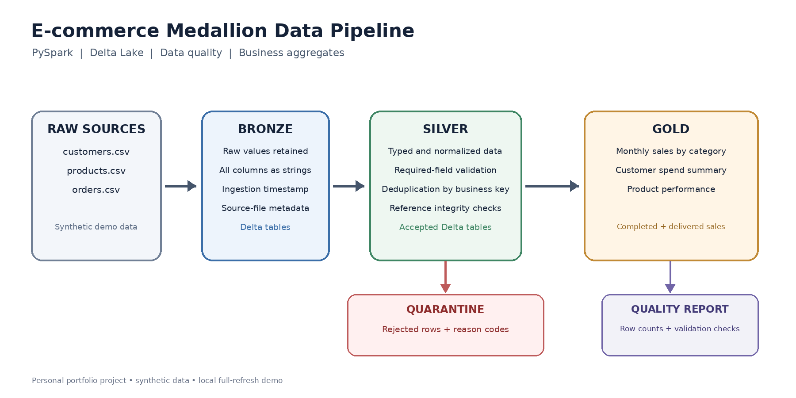

# E-commerce Medallion Data Engineering Pipeline

A portfolio-ready, end-to-end batch data engineering project built with **Python, PySpark, and Delta Lake**. It demonstrates how raw CSV files can be transformed into quality-checked Silver tables and business-facing Gold aggregates using a Bronze/Silver/Gold medallion architecture.

All included business records are **synthetic demo data**. No cloud account or real customer information is required.

## Architecture



Source files → Bronze Delta tables → Silver cleaning and validation → Gold analytics. Invalid and duplicate records are written to a Silver quarantine area with a `rejection_reason`, so rejected data can be investigated rather than silently discarded.

The editable Mermaid diagram is available at [`docs/architecture.mmd`](docs/architecture.mmd).

## What the pipeline does

### Bronze
- Reads the three CSV inputs with source values retained as strings.
- Adds ingestion timestamp and source file metadata.
- Writes local Delta tables under `data/lake/bronze/`.

### Silver
- Converts identifiers, dates, quantities, and prices to typed columns.
- Normalizes text fields and email addresses.
- Validates required fields, prices, quantities, dates, and order statuses.
- Checks customer and product references for incoming orders.
- Deduplicates customer, product, and order keys deterministically.
- Writes accepted records to `data/lake/silver/` and rejected records with reason codes to `data/lake/silver/_quarantine/`.

### Gold
Builds three analytics tables from orders whose status is `COMPLETED` or `DELIVERED`:

| Gold table | Purpose |
|---|---|
| `monthly_sales` | Sales by year, month, and product category |
| `customer_summary` | Completed order count, total spend, and average order value per customer |
| `product_performance` | Units sold, completed orders, and revenue by product |

Revenue excludes cancelled, pending, processing, and shipped orders. This is a deliberate demo business rule; change `REVENUE_STATUSES` in `src/medallion_pipeline/config.py` if a project requires another policy.

### Quality report

After a successful run, `reports/quality_report.json` records source, Bronze, Silver, quarantine, and Gold row counts, as well as key uniqueness and non-negative revenue checks.

## Technology stack

- Python 3.10+
- Apache Spark / PySpark 4.2.0
- Delta Lake / `delta-spark` 4.4.0
- Spark SQL and the DataFrame API
- pytest for source-data contract tests

Delta Lake 4.4.0 supports Apache Spark 4.2.0. See the [Delta Lake release compatibility notes](https://docs.delta.io/releases/) and [PySpark installation guide](https://spark.apache.org/docs/latest/api/python/getting_started/install.html).

## Run on Ubuntu

Java 17 or later is required by this Spark release. Python 3.10 or later is supported; Python 3.12 is a suitable choice.

```bash
# 1. Check your Java version
java -version

# 2. From the project folder, create and activate a virtual environment
python3 -m venv .venv
source .venv/bin/activate

# 3. Install pinned Spark / Delta dependencies
python -m pip install --upgrade pip
pip install -r requirements.txt

# 4. Run the full local pipeline
python scripts/run_pipeline.py

# 5. View the Gold table results
python scripts/inspect_gold.py

# 6. Run the dependency-light checks for the included raw data
pytest -q
```

The first full pipeline run needs internet access to download the Delta Lake JVM package through Maven if it is not already cached. No Azure credentials are needed because this version writes to the local filesystem.

If `python3.12-venv` is missing on Ubuntu, install it with your system package manager. If you use a different Python executable, substitute that executable in the virtual-environment command.

## Rerunning and cleaning

The demo runs as a **full refresh**: each run overwrites the local Bronze, Silver, quarantine, and Gold tables, making the small sample easy to reproduce. It is not an incremental production ingestion framework.

To remove generated Delta data and the latest quality report:

```bash
make clean
```

## Project layout

```text
.
├── data/
│   ├── raw/                  # Synthetic CSV source data
│   └── lake/                 # Generated Bronze, Silver, and Gold Delta tables
├── docs/
│   ├── architecture.mmd      # Editable Mermaid architecture
│   ├── architecture.png      # Portfolio-friendly architecture image
│   └── portfolio_entry.md    # Suggested Upwork portfolio text
├── reports/                  # Generated quality_report.json
├── scripts/
│   ├── run_pipeline.py
│   └── inspect_gold.py
├── src/medallion_pipeline/
│   ├── config.py
│   └── pipeline.py
├── tests/
└── requirements.txt
```

## Limitations and next steps

This is an intentionally small local demo, designed to demonstrate the engineering pattern rather than claim production scale. A production deployment would normally add source-specific contracts, orchestration (for example Airflow or Azure Data Factory), structured logging and alerting, incremental processing, access controls, environment-specific configuration, cloud storage integration, and CI/CD.

For an Upwork portfolio, label this clearly as a **personal project**. Run it, inspect the output, and attach genuine screenshots from your own execution before publishing the entry.
